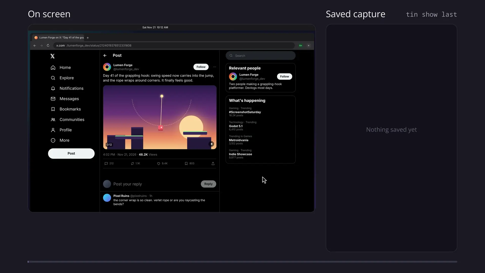

<div align="center">
  <h1>Tin</h1>
  <p>Capture what you're looking at, say what it's for, and hand it to an agent.</p>
  <p><a href="#install">Get started</a> · <a href="docs/media/capture-demo.mp4">Play demo in 4K60</a></p>
  <a href="docs/media/capture-demo.mp4"></a>
</div>

Tin is an open-source take on [Copper](https://shadcn.com/copper): a to-do list, clipboard and
scratchpad for AI-assisted work. Double-tap Shift and pick what you're looking at (a window,
something inside it, or an area), and Tin keeps it with the page it's on (a tweet is recognised
as one). Add a voice note with [Hex](https://github.com/anomalyco/hex),
then type or say what it's for ("ask blog", "game dev", "new project: pixel farm"). Tin routes it
to a project and saves it as a plain JSON file that agents can read, act on and check off.

Linux and macOS. Everything stays on your machine: no account, no sync. Tin only goes online to
keep copies of a tweet or of a page's images and videos you captured.

## Install

```sh
cargo install --path crates/tin       # the `tin` CLI
cargo install --path crates/tin-app   # the window (built with Rune)
```

Linux builds of `tin-app` need `libxkbcommon` and `wayland` development packages
(`apt install libxkbcommon-dev libwayland-dev`). Reading the selection needs `wl-clipboard` on
Wayland, or `xclip`/`xsel` on X11. Voice notes need [Hex](https://github.com/anomalyco/hex)
running (`hex start`).

## Capture

With `tin-app` running (`tin-app --background` at login), **double-tap Shift**. Tin freezes every
monitor and dims them:

- The element under the cursor lights up, on any monitor: a button, a message, a panel, or the
  whole window. **Scroll up** to grow it to what's around it, **down** to shrink it. **Click**
  picks it; **drag** picks an area instead. **Esc** closes.
- A small card opens with what you picked, and Hex starts listening. Say what it's about; type
  what it's for if you like.
- **Enter** saves (the cropped picture, your transcript, the window, and the page if it's a
  browser). **Esc** throws the capture away.

Two quick taps of the same Shift do it; typing a capital or holding Shift never does. Turn it off
with `[app] double_shift = false`. On Linux it reads the keyboard from `/dev/input`, so you need
to be in the `input` group (`sudo usermod -aG input $USER`, then log in again). On macOS it needs
Accessibility permission. Tin only looks at Shift and "some other key"; it keeps nothing you type.
Elements come from the app's accessibility tree when it publishes one (GTK, Qt, Firefox;
Chromium and Electron apps started with `--force-renderer-accessibility`), with their role and
name saved in the capture, along with the element's text and links (`selection.content`). Tin switches the session's accessibility bus on when it starts and
before each pick. Anything else (terminals, games, apps that publish nothing) is cut into
blocks from its pixels. The picker needs COSMIC for now: it reads windows and the screens through COSMIC's protocols,
without a portal or prompt, and draws over each monitor with a layer-shell surface. macOS isn't
built yet.

You can also bind **`tin-app --capture`** to a key in your desktop's keyboard settings.
`tin capture` and the window's **Capture clipboard** use the older text panel, which has:

- **Text**: the selection, editable. If nothing came through, paste it in.
- **Page**: the browser's active tab, as a link or a tweet. ✕ drops it.
- **What's it for?**: Tin shows where it routes as you type.
- **🎙 Voice note**: records with Hex until you press Stop, then shows the transcript. What you say
  routes too ("this is for blog").
- **Enter** saves and hides the window. **Esc** discards.

You can also set `[app] shortcut = "ctrl+alt+c"` in the config to have the running app register a
global shortcut itself. That works on macOS, X11 and Wayland desktops with the GlobalShortcuts
portal.

The window lists open captures. Click the circle to check one off, double-click (or select it and
press ⌘C / Ctrl+C) to copy it with its URL, and use the field at the bottom to queue a note or
your next prompt.

From a terminal:

```sh
tin capture --for "ask blog about pricing"      # selection + active tab
tin capture --voice --for "game dev"            # plus a Hex voice note; Enter stops
tin capture --clipboard --note "compare later"  # the clipboard instead of the selection
echo "idea" | tin capture --stdin --no-page --for "new project: pixel farm"
tin context                                     # what a capture would pick up now, and why not
```

## Routing

What you say a capture is for becomes its **intent**:

| You say | Target | Tags |
|---|---|---|
| `ask blog`, `blog.com` (a configured alias) | project `blog` and its folder | `blog` |
| `for tin` (a folder in a project root) | project `tin` | `tin` |
| `game dev` (a route without a folder) | undecided | `game-dev` |
| `new project called pixel farm` | new project "pixel farm" | `new-project` |
| `#pricing` | | `pricing` |

Folders under `~/dev`, `~/code`, `~/src`, `~/projects` and `~/Developer` count as projects. Since
folder names are often ordinary words, they match only after a cue word ("for tin", "ask tin",
"to tin") or as the whole purpose. Configured routes match anywhere. `tin init` writes a
commented config (`tin paths` shows where):

```toml
project_roots = ["~/dev"]

[[route]]
name = "blog"
aliases = ["ask blog", "blog.com"]
path = "~/dev/blog"
hook = ["opencode", "run", "--dir", "~/dev/blog", "Triage the capture on stdin"]

[[route]]
name = "game dev"     # a topic: tags captures, names no project

[hooks]
on_capture = ["notify-send", "Tin", "Captured"]
```

## Browser extension

`extension/` is a small Chromium extension (Helium, Chrome, Edge, Brave) that tells Tin:

- which page each window shows, so captures don't guess from session files;
- what's selected in the page (COSMIC doesn't share the selection with other apps);
- the tweets X's own app loads, whole: long posts in full, with their photo and video URLs;
- when you pick part of a page, the images and videos there. Tin downloads them into
  `<id>.media/` (`page-1.jpg`, …) and lists them in the capture (`selection.content.media`).
  Streamed videos (`blob:` addresses) can't be downloaded; the capture says so and its picture
  shows them.

It talks to Tin through native messaging: the browser runs the `tin` command as a helper, which
writes what it hears to `<data>/browser/` (seen tweets are kept 14 days). For Tin's questions the
extension keeps one helper open, which listens on `$XDG_RUNTIME_DIR/tin-<browser>.sock`. No
network port is opened. Set it up once:

```sh
tin extension install   # registers the helper with Helium
```

then open `helium://extensions`, turn on Developer mode, **Load unpacked** and pick `extension/`.
`tin extension status` shows what it has reported. Its tests: `node --test extension/test`.

## Kept tweets

Pick a tweet on X and Tin saves the tweet's own link (`x.com/<handle>/status/<id>`, read from
the links inside what you picked), then keeps a copy in case it's deleted: its text, author,
time and quoted tweet in the capture, the raw record as `<id>.tweet.json`, and photos (original
size) and videos (best MP4) in `<id>.media/`. With the extension, the copy is what X's app
loaded (long posts whole); without it, X's public embed data, which cuts long posts short. `tin archive <capture>` retries or keeps one later.

## For agents

Each capture is one file, `~/.local/share/tin/captures/<id>.json` (macOS:
`~/Library/Application Support/tin/captures`). Ids sort by time.

```json
{
  "id": "20261120-184741-820-bdd9",
  "created_at": "2026-11-20T18:47:41.820Z",
  "status": { "state": "open" },
  "text": { "text": "Use stencil buffers for portals", "from": "selection" },
  "page": {
    "url": "https://x.com/shadcn/status/2082519375194763675",
    "title": "shadcn on X: \"Launching Copper…\" / X",
    "kind": { "type": "tweet", "handle": "shadcn", "status_id": "2082519375194763675",
              "author": "shadcn", "text": "Launching Copper…" },
    "via": { "type": "browser_tab", "browser": "Helium", "focused": true }
  },
  "voice": { "transcript": "Compare with our onboarding queue.", "engine": "hex" },
  "screenshot": { "path": "/home/me/.local/share/tin/captures/20261120-184741-820-bdd9.png",
                  "width": 1920, "height": 984 },
  "intent": {
    "said": "ask blog about this",
    "target": { "type": "project", "name": "blog", "path": "/home/me/dev/blog", "matched": "ask blog" },
    "tags": ["blog"]
  }
}
```

- `tin list --json [--route blog] [--done|--all]` lists captures; `tin show <id> --json` shows one.
- `tin done <id>` checks one off; `tin route <id> <purpose>` routes it again.
- Ids accept `last` or any unique prefix or suffix.
- Hooks get the capture JSON on stdin, with `TIN_CAPTURE_ID` and `TIN_CAPTURE_FILE` set. Route hooks
  run when a capture is tagged with that route.

## How context is read

| | Linux | macOS |
|---|---|---|
| Selection | primary selection (`wl-paste --primary`, `xclip`, `xsel`) | ⌘C through System Events, then the clipboard is restored |
| Focused window | COSMIC (toplevel-info protocol), Hyprland, Sway, niri, KDE (`kdotool`), X11 (`xdotool`) | System Events |
| Active tab | the page you picked, from the browser's accessibility tree; else the browser's session file (the tab titling the focused window) | the browser's AppleScript, else its session file |
| Window picture | COSMIC (`ext-image-copy-capture`), when the window isn't a browser | not yet |

Tin reads Chromium-family session files (Chrome, Helium, Brave, Edge, Vivaldi, Arc, Chromium,
Thorium) and Firefox-family session stores (Firefox, Zen, LibreWolf). No extension is needed.
Chromium writes its session a few seconds after you switch tabs, so capture immediately after a
switch may still show the previous tab.

Known limits:

- Some Wayland desktops (GNOME) don't tell other apps which window is focused. Tin then
  takes the most recently used browser's tab, marks it `"focused": false`, and shows it as
  "guessed" in the panel.
- COSMIC doesn't share the primary selection with other apps. Copy, then double-tap Shift: the
  app falls back to the clipboard and labels the text "from the clipboard".
- macOS needs Accessibility (and Automation, for browsers) permission for Tin or your terminal.

## Development

```sh
cargo test --workspace
cargo run -p tin-app                                        # the window
target/debug/tin-app --snap out.png --scene composer        # headless render (Rune tooling)
target/debug/tin-app --picker --snap out.png --scene heard  # the capture card, on a made-up desktop
target/debug/tin-app --scene heard --script s.json --frames 30
```

`TIN_DATA_DIR` and `TIN_CONFIG` point Tin at another store and config.

- `crates/tin-core`: capture model, context readers, routing, store, Hex client.
- `crates/tin`: the CLI.
- `crates/tin-app`: the [Rune](https://github.com/anomalyco/rune) app. Rune is pre-release and pinned
  to one `dev` revision in the workspace `Cargo.toml`, with its patches.

MIT.
